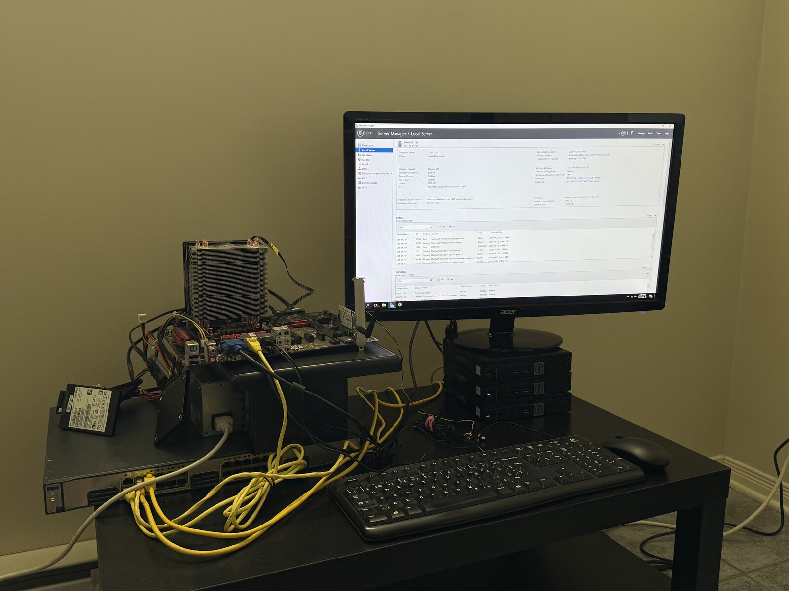
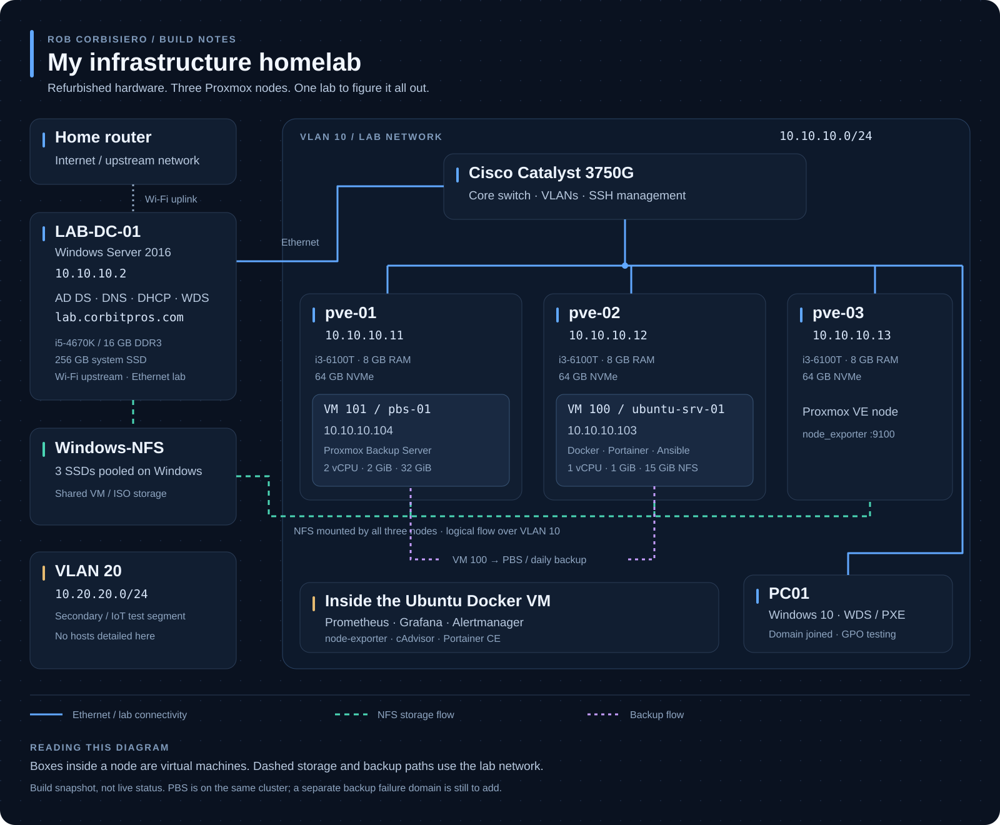
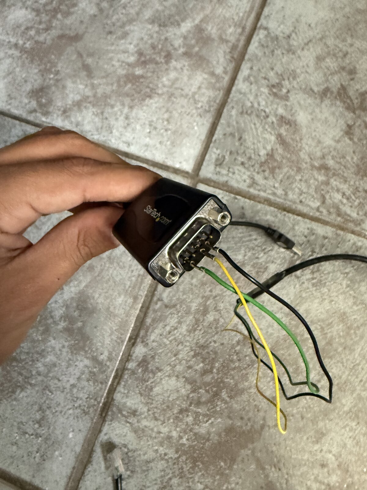
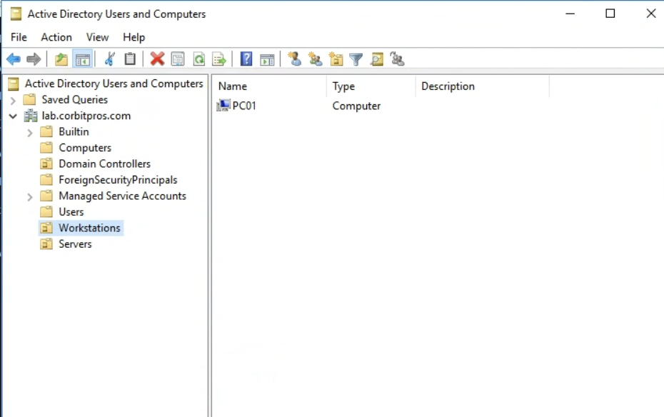
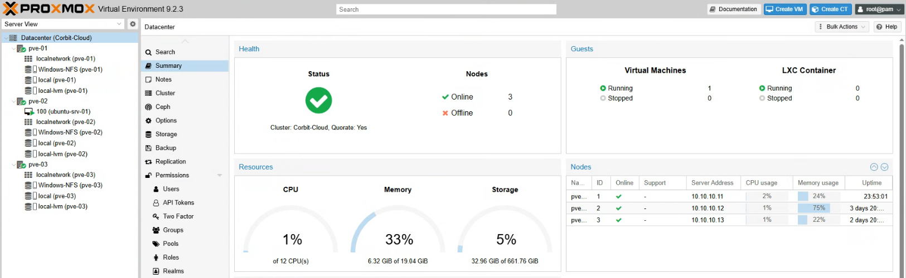
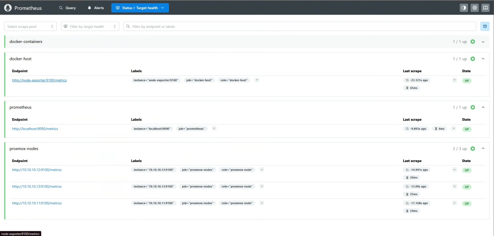
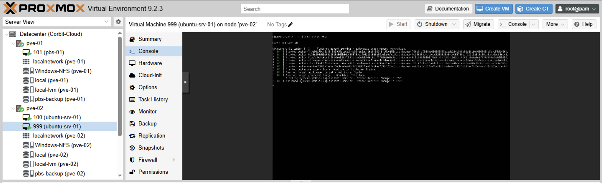

# My Infrastructure Homelab

I built this lab out of refurbished desktops, mini PCs, and a Cisco 3750G. I wanted to get hands-on with the stuff I'd be supporting as a systems administrator: switching, Active Directory, Windows deployment, virtualization, Linux, backups, and monitoring.

It started with a switch that wouldn't boot and a homemade console cable. From there I built a three-node Proxmox cluster, set up Windows Server services, imaged a client over the network, and got a Docker host backed up and monitored. These are my notes, commands, photos, and screenshots from that build. They describe what I tested at the time, rather than a live status page.

## The setup

| Hardware | What I used it for |
| --- | --- |
| Cisco Catalyst 3750G | Lab switching, VLANs, and management access |
| Custom desktop: i5-4670K, 16 GB DDR3, 256 GB SSD | Windows Server 2016: AD DS, DNS, DHCP, WDS, and NFS storage |
| Three mini PCs: i3-6100T, 8 GB RAM, 64 GB NVMe each | Proxmox nodes `pve-01`, `pve-02`, and `pve-03` |
| Pooled SSDs on Windows Server | Shared storage mounted in Proxmox as `Windows-NFS` |
| Spare mini PC | Windows 10 client deployed through WDS |

[Full hardware list](hardware-inventory.md) · [VM inventory](proxmox/vm-inventory.md) · [Photos](photos/) · [Screenshots](screenshots/)

## Network

[Open full-size SVG](diagrams/homelab-topology.svg) · [PNG copy](diagrams/homelab-topology.png)

The solid lines show lab connections; the dashed NFS and backup paths are logical flows over that network. VMs sit inside the Proxmox node that hosted them during the build.

| Segment | Use | Network |
| --- | --- | --- |
| VLAN 1 | Initial switch management and recovery | Depended on the home network |
| VLAN 10 | Lab servers and management | `10.10.10.0/24` |
| VLAN 20 | Secondary/IoT test segment | `10.20.20.0/24` |

The AD domain was `lab.corbitpros.com`. The Windows Server desktop used Wi-Fi for upstream internet and Ethernet for the lab switch. That arrangement gave me a few routing and DNS problems to work through before the Ubuntu VM could reach the internet reliably.

## What I built

### Getting the Cisco switch working

The 3750G was stuck at `switch:`. I didn't have a Cisco console cable, so I put together a temporary connection with a StarTech USB-to-DB9 adapter, an Ethernet cable, and Dupont wires. Once PuTTY connected, I inspected flash, cleared the BOOT variable, and booted IOS using the full image path.

[Console cable and pinout](networking/switch-console-access.md) · [Recovery commands](networking/cisco-switch-recovery.md) · [VLAN and switch notes](networking/cisco-3750g-lab.md)

### Windows Server, Active Directory, and imaging

I originally tried Windows Server 2025, but the older Wi-Fi card kept giving me driver errors. Server 2016 worked with the hardware, so I used that for AD DS, DNS, DHCP, and WDS.

I used WDS to PXE-boot a spare mini PC, install Windows 10, and join it to the domain. After renaming it `PC01`, I moved it into a `Workstations` OU and tested a mapped drive and screensaver lock through Group Policy. The user settings needed loopback processing before they applied correctly.

[Server install](windows-server/windows-server-2016-install.md) · [AD, DNS, and DHCP](windows-server/active-directory.md) · [WDS walkthrough](windows-server/windows-deployment-services.md) · [Group Policy commands and fixes](windows-server/group-policy.md)

### Proxmox, shared storage, and Docker

I clustered three mini PCs and mounted the Windows Server SSD pool over NFS. The Ubuntu VM ran on `pve-02` with a 15 GiB disk on that shared storage. I set up SSH keys, tested a second login before disabling passwords, then installed Docker and Portainer.

[Cluster and VMs](proxmox/vm-inventory.md) · [Windows NFS](proxmox/windows-nfs-storage.md) · [Ubuntu and SSH](proxmox/ubuntu-server-vm.md) · [Docker setup](proxmox/docker-host.md)

### Monitoring and automation

I deployed Prometheus, Grafana, Alertmanager, node-exporter, and cAdvisor on the Docker host, with a native node_exporter service on each Proxmox node. The screenshot below shows the scrape targets reachable during testing. Alertmanager's notification receiver is still a placeholder in the checked-in config.

After installing node_exporter manually on all three nodes, I wrote an Ansible playbook to repeat the setup. Its second run reported `changed=0` on all three. The original Docker playbook ran against an already configured host. I've since corrected its APT architecture setting and replaced the raw Compose command with the Compose module; the notes distinguish those code fixes from the older lab results.

[Monitoring setup and configs](monitoring/monitoring-stack.md) · [Ansible playbooks and run results](ansible/automation.md)

### Backups I actually restored

I set up Proxmox Backup Server and a daily job for the Ubuntu VM. The first backup said `OK`, but the PBS datastore was empty: I'd left the destination on `local`. Selecting `pbs-backup` fixed that.

I restored the PBS snapshot into a separate VM (`999`) and confirmed it booted, including Docker and containerd. PBS lived on the same cluster, so this tested backup and restore without giving me a separate failure domain.

[PBS setup, storage mistake, and restore test](proxmox/backup-and-disaster-recovery.md)

## Remote access

I also kept the [Tailscale access notes](networking/remote-access-tailscale.md): reach the Windows host through the tailnet, then manage the lab from that desktop. The setup still needs its own screenshots and an outside-network test recorded here.

## Things that went wrong

The useful part of this lab was figuring out why something didn't work: losing switch SSH after changing the uplink, a Docker repository key error, Group Policy reaching the computer but not the user, and a successful backup going to the wrong place.

I kept those in the [troubleshooting log](troubleshooting-log.md), with the fixes and what I checked afterward. The shorter version is in [what I learned](lessons-learned.md).

## Still to improve

- Give PBS separate storage or an offsite copy.
- Configure an actual Alertmanager notification receiver and test delivery.
- Add Windows Server metrics and more Grafana dashboards.
- Test the revised playbooks on a fresh host and check an exporter version upgrade.
- Record the NFS export path and storage pool details.
