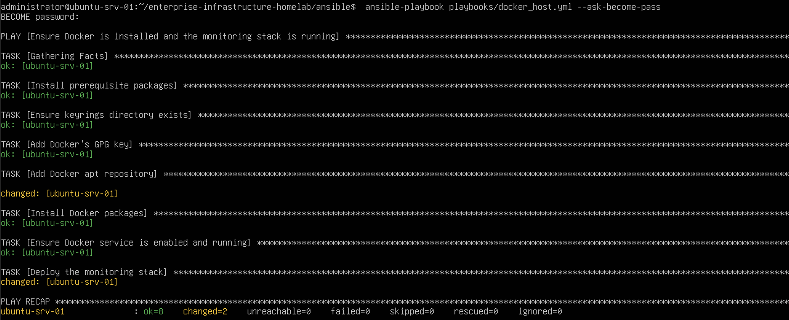
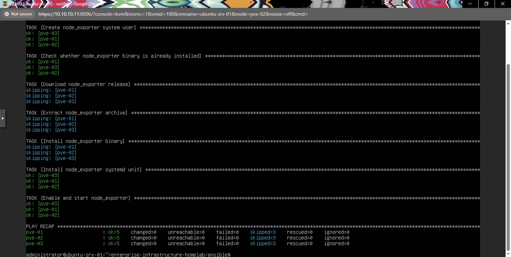

# Automating the lab with Ansible

I started by installing node_exporter manually on all three Proxmox nodes. These playbooks let me repeat that setup and configure the Ubuntu Docker host from the same repo.

## Where to run it

The control node is `ubuntu-srv-01` (`10.10.10.103`). Run from a checkout of this repo on that VM. The Docker inventory entry uses `ansible_connection=local`; the Proxmox nodes use SSH as root.

```bash
sudo apt update
sudo apt install -y ansible
cd ansible
ansible-galaxy collection install -r requirements.yml
```

The addresses are in [inventory/hosts.ini](inventory/hosts.ini). I used an SSH key on the control node and copied its public key to the three Proxmox hosts:

```bash
ssh-keygen -t ed25519 -f ~/.ssh/id_ed25519
ssh-copy-id root@10.10.10.11
ssh-copy-id root@10.10.10.12
ssh-copy-id root@10.10.10.13
```

If a key already exists, use that rather than overwriting it.

## Proxmox node_exporter

[node_exporter.yml](playbooks/node_exporter.yml) creates the service user, downloads the pinned amd64 release, checks its SHA-256 checksum, installs the binary and systemd unit, and starts the service.

```bash
ansible-playbook playbooks/node_exporter.yml
```

The earlier playbook only checked whether the binary existed. That skipped installation even when I changed the version pin. It now checks the reported version and restarts the service when the binary changes. When changing the release, update both `node_exporter_version` and `node_exporter_checksum` using the release's published checksum list.

## Ubuntu Docker host

Before running [docker_host.yml](playbooks/docker_host.yml), create the local monitoring environment file and choose a Grafana password:

```bash
# From the repository root
cp monitoring/.env.example monitoring/.env
nano monitoring/.env
chmod 600 monitoring/.env
cd ansible
ansible-playbook playbooks/docker_host.yml --ask-become-pass
```

The playbook uses the checkout it runs from. It installs Docker's official packages and starts the monitoring stack with `community.docker.docker_compose_v2`. The collection is pinned in [requirements.yml](requirements.yml). Compose must be version 2.18 or newer.

Two fixes came out of reviewing the original playbook:

- Docker's APT source now uses `dpkg --print-architecture`. The old `ansible_architecture` fact produces `x86_64` on these hosts, while APT needs `amd64`.
- The Compose module replaces the raw `docker compose up -d` command so Ansible can report whether the deployment changed.

The playbook checks that `monitoring/.env` exists; Compose also rejects an empty or missing password. The environment setting initializes a new Grafana admin account. It does not rotate the password in an existing Grafana database; change that through Grafana itself.

## What the screenshots show

These screenshots are from the original lab runs, before the fixes above. They remain useful records, but they do not validate the revised playbooks on a clean host.



The Docker run reported `ok=8, changed=2, failed=0`. Docker was already installed manually, so that result did not catch the repository architecture bug. The old Compose command also reported a change every run.



The exporter playbook's second run reported `changed=0` on all three nodes. That checked the original installed state, not an upgrade.

## Repository checks

The [Lint workflow](../.github/workflows/lint.yml) runs YAML linting, Ansible linting, and Compose validation. It also checks that Compose fails when the required Grafana password is absent. These checks do not connect to the lab or deploy anything.

A fresh-host deployment, exporter version change, and repeat run against the lab are still needed to validate the revised automation on the actual machines.
