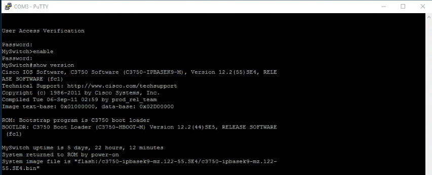
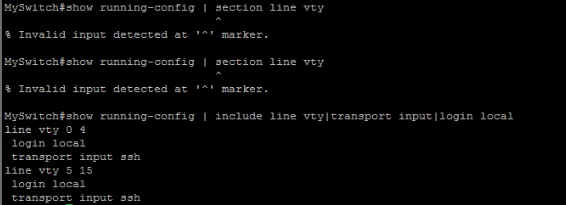
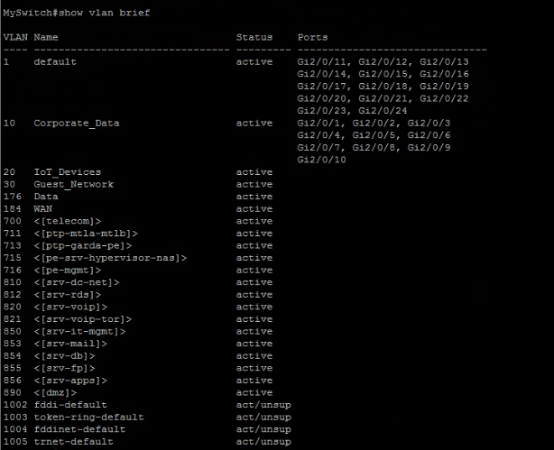
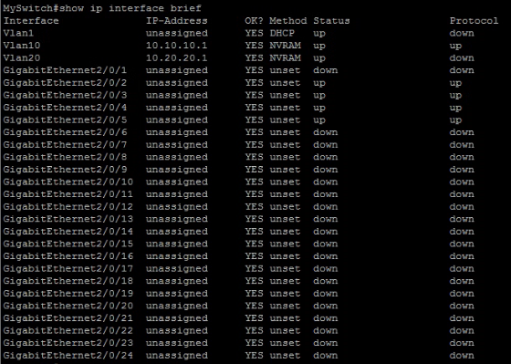

# Cisco 3750G Lab Configuration

## What I was doing

Once the 3750G booted, I used it for the lab network and worked through management access, VLANs, and basic routing checks.

## What I worked through

### Management access

I configured the switch for remote administration after console recovery.

Key tasks:

- I confirmed IOS boot.
- I entered privileged EXEC mode.
- I prepared the switch for SSH-based management.
- I validated that console access remained available during management changes.

Screenshot:





### VLANs and ports

I started segmenting the lab network into dedicated VLANs.

Example VLAN plan:

| VLAN | Purpose | Example Network |
| --- | --- | --- |
| VLAN 10 | Lab servers and management | `10.10.10.0/24` |
| VLAN 20 | Secondary/IoT test network | `10.20.20.0/24` |
| VLAN 30 | Guest network | Planned guest segment |
| VLAN 184 | WAN/uplink segment | Lab uplink segment |

Operational note:

- Port 1 was initially connected to the home router for internet/uplink access.
- Changing port 1 configuration caused SSH management to drop.
- Access was restored by correcting the management path.

Screenshot:



### Layer 3 preparation

I used the Catalyst 3750G as a platform for learning Layer 3 switching concepts.

Key tasks:

- I planned switched virtual interfaces (SVIs).
- I reviewed the need for `ip routing` when routing between VLANs locally.
- I tested connectivity between the switch and Windows Server.
- I validated server reachability after correcting addressing and port configuration.

Screenshot:



## Validation Commands

Useful commands during this lab:

```text
show ip interface brief
show vlan brief
show running-config
show ip route
ping 10.10.10.2
```

## Lessons Learned

- Management access should be protected before changing uplink or access-port behavior.
- Console access is the recovery path when SSH is lost.
- Layer 2 port membership, SVI state, and host firewall behavior can all affect ping tests.
- The 3750G is useful for learning both switching and basic routing concepts.
