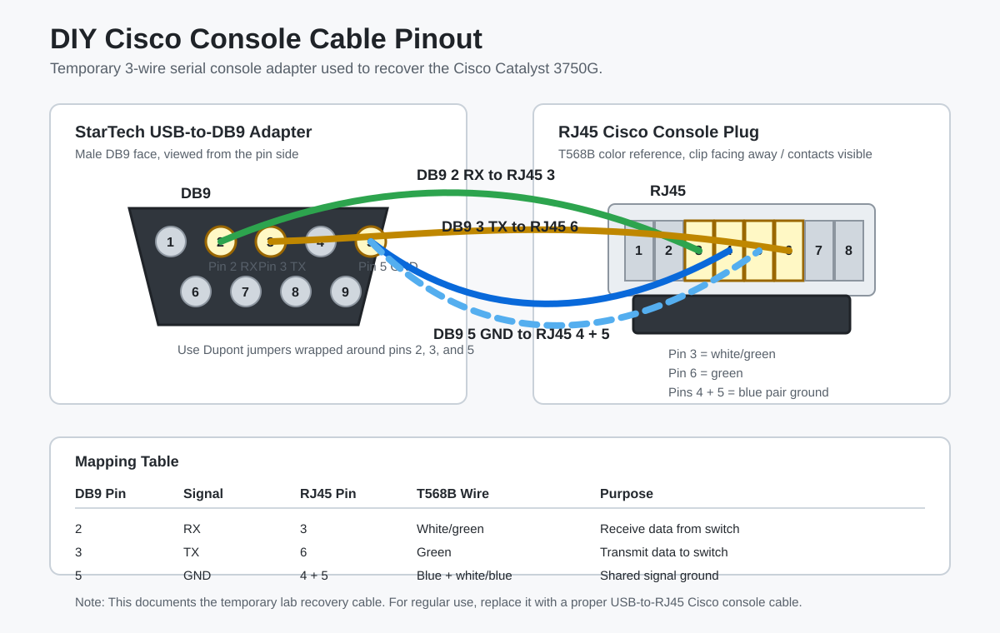

# Cisco Console Access

## What I was doing

I didn't have a Cisco console cable, so I made a temporary three-wire serial connection from parts I had available. This got me into the 3750G bootloader through PuTTY.

## Equipment Used

- Windows 11 laptop
- StarTech USB-A to male DB9 serial adapter
- Standard Ethernet cable
- Dupont connector wires
- PuTTY
- Cisco Catalyst 3750G switch

Photos of the temporary cable and physical setup are stored in [../photos](../photos/).

Pinout diagram:

## Serial Settings

| Setting | Value |
| --- | --- |
| Connection type | Serial |
| Speed | `9600` |
| Data bits | `8` |
| Parity | `None` |
| Stop bits | `1` |
| Flow control | `None` |

## Process

1. I connected the StarTech USB-to-DB9 adapter to the Windows 11 laptop.
2. I confirmed the adapter appeared in Device Manager under Ports (COM & LPT).
3. I used PuTTY to open the detected COM port.
4. I built a temporary serial connection using Dupont connector wires wrapped around the male DB9 pins.
5. I connected the RJ45 end into the Cisco console port.
6. I pressed Enter in PuTTY until the switch responded.

## Important Notes

- The StarTech adapter was not cut open because it contains active USB-to-serial electronics.
- Only the required serial lines were used for the temporary connection.
- Each temporary pin connection was isolated so adjacent DB9 pins would not touch.
- This was a lab recovery method, not a permanent cabling standard.

## Pinout Used

| DB9 pin | Signal | RJ45 pin | T568B wire |
| --- | --- | --- | --- |
| 2 | RX | 3 | White/green |
| 3 | TX | 6 | Green |
| 5 | Ground | 4 and 5 | Blue and white/blue |

## How it turned out

PuTTY successfully connected to the Cisco switch and displayed the `switch:` bootloader prompt.
