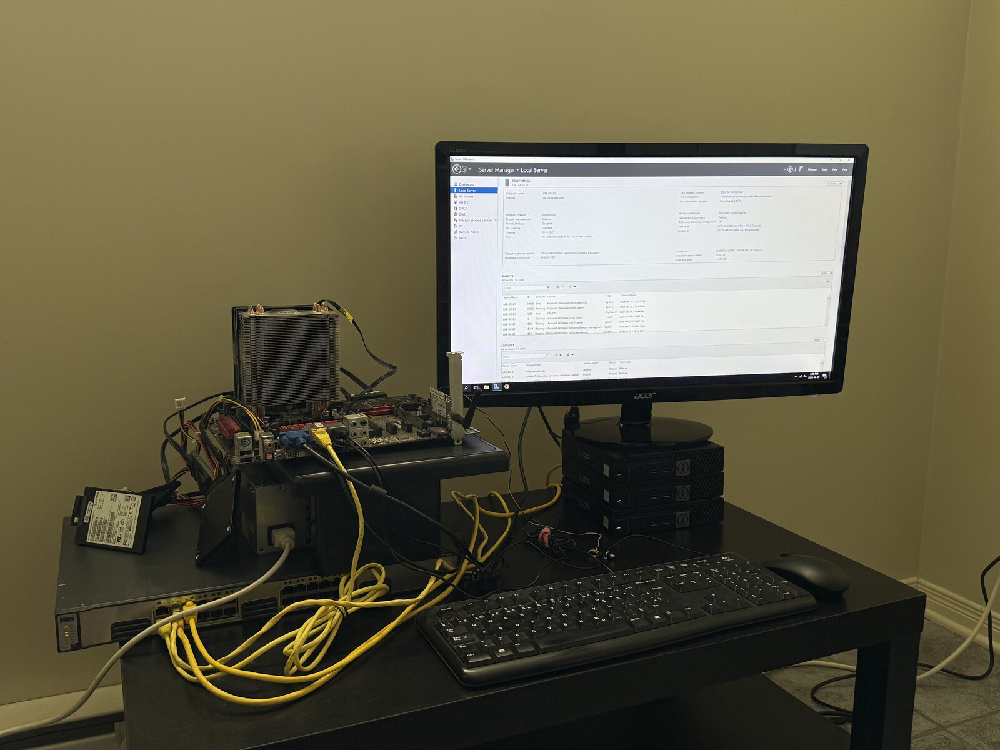
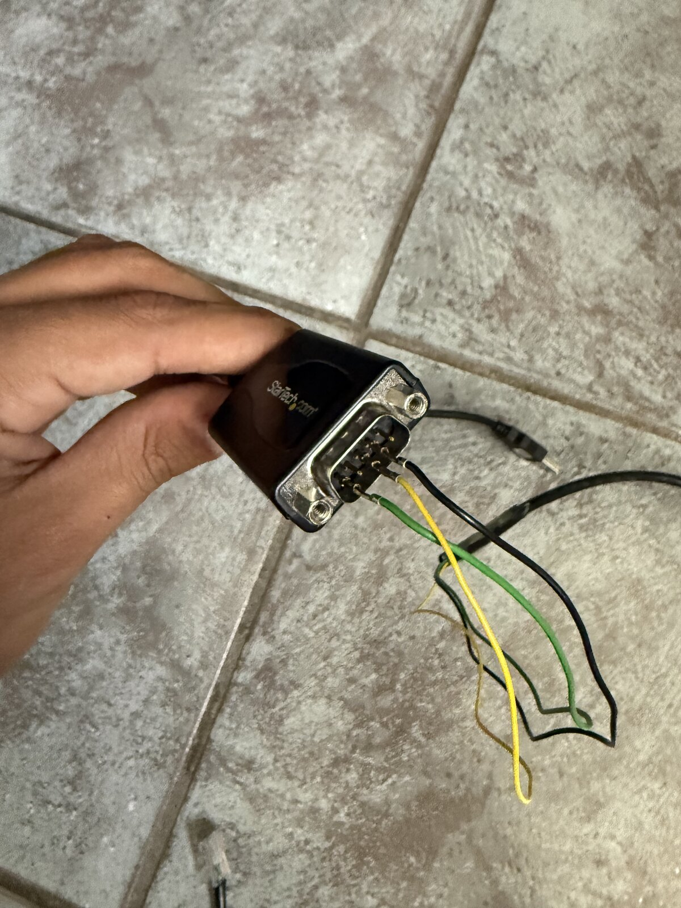
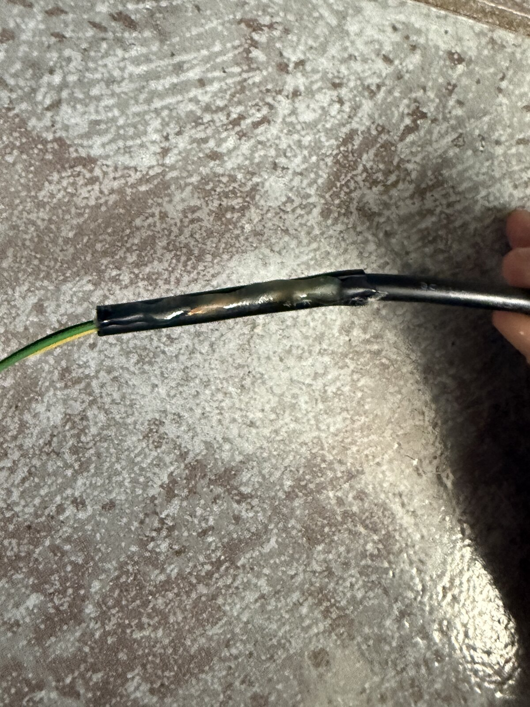
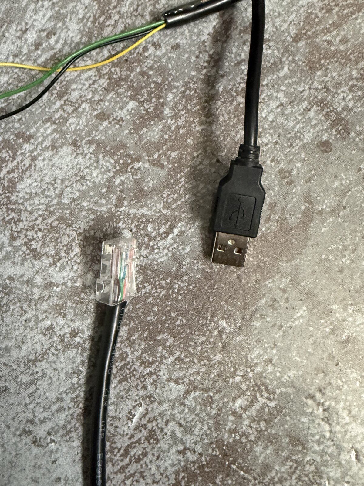
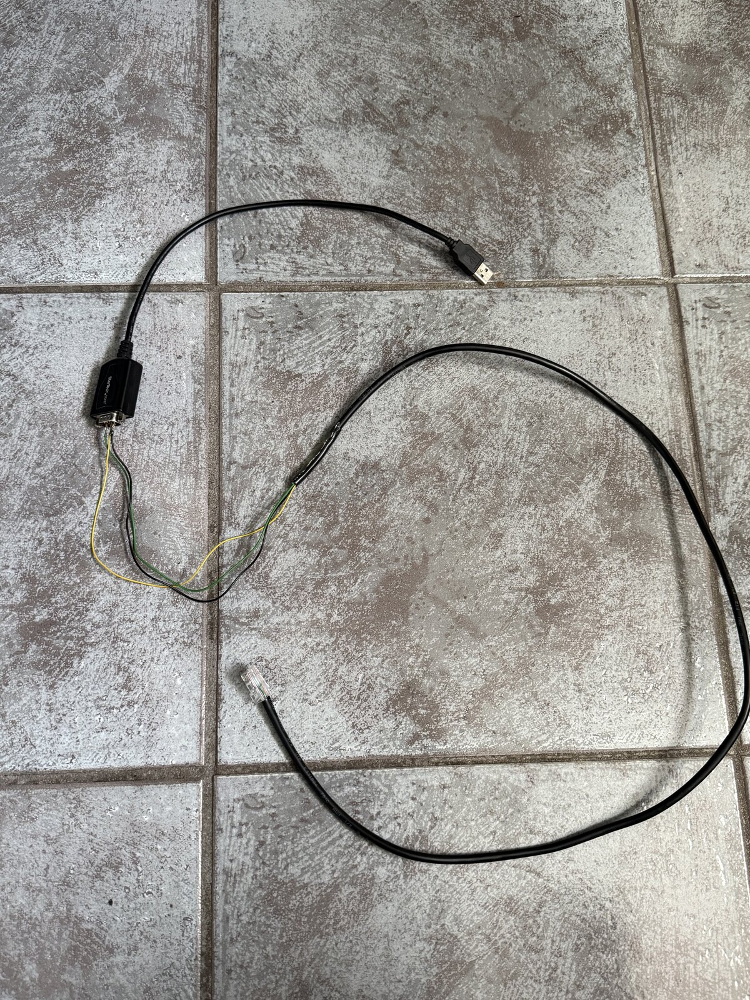

# Homelab Photos

Photos of my lab setup and the temporary cable I made to recover the Cisco switch.

## Preview

| Homelab setup | Console cable |
| --- | --- |
|  |  |

## Gallery

| Photo | Description |
| --- | --- |
|  | Physical homelab setup with Cisco switch, Windows Server host, and mini PCs. |
|  | Temporary console cable connected to the StarTech USB-to-DB9 adapter. |
|  | Spliced cable section wrapped and insulated. |
|  | RJ45 and USB sides of the temporary console cable. |
|  | Full temporary DIY console cable assembly. |

## Notes

The DIY cable was a temporary recovery fix. The [console notes](../networking/switch-console-access.md) include the pinout and PuTTY settings.
