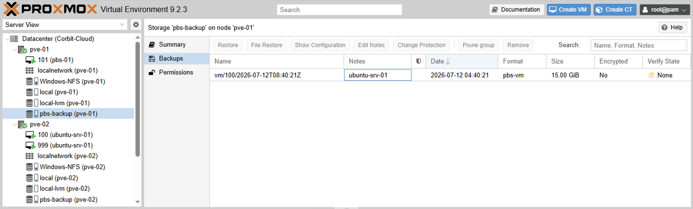
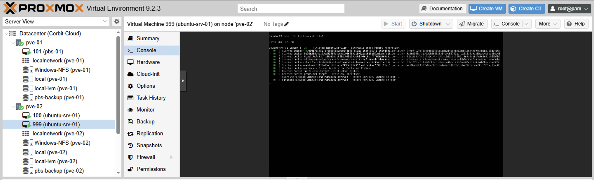

# Backup and Disaster Recovery

## What I was doing

I set up PBS for the Ubuntu Docker VM, scheduled a daily backup, and restored a snapshot into a separate VM to check that it booted.

## Architecture

```text
pve-01, pve-02, pve-03 (Proxmox VE cluster)
        |
        | Backup job (scheduled + on-demand)
        v
pbs-01 (Proxmox Backup Server VM, 10.10.10.104)
        |
        v
Datastore: backup-datastore
```

I ran PBS as its own VM (`pbs-01`, VMID 101) on `pve-01` — 2 vCPU, 2 GB RAM, 32 GB disk — using a separate guest installation.

PBS and the VMs it backed up lived on the same cluster. I tested backup and restore here, but a cluster or storage failure could still affect both. Separate backup hardware or an offsite copy is the next improvement.

## Datastore and Access Control

A datastore (`backup-datastore`) was created on `pbs-01`, backed by a directory on its local disk.

I connected Proxmox VE with a dedicated backup account:

- User: `backup-svc@pbs`
- Permission: `DatastoreBackup` role scoped to `/datastore/backup-datastore` (backup/restore only, no datastore administration)

This account, along with the PBS server's TLS fingerprint, was used to register PBS as a storage target in Proxmox VE (`Datacenter → Storage → Add → Proxmox Backup Server`, ID `pbs-backup`).

## Backup Job

A scheduled backup job targets `ubuntu-srv-01` (VMID 100):

| Setting | Value |
| --- | --- |
| Storage | `pbs-backup` |
| Selection | VMID 100 (`ubuntu-srv-01`) |
| Schedule | Daily |
| Retention | Keep Last 3 |

## Troubleshooting: Backups Landing on Local Storage Instead of PBS

**Symptom:** The backup job ran and reported `OK` in the task log, but the PBS datastore showed `0 Groups, 0 Snapshots` for VMs — nothing had actually reached PBS.

**Cause:** The completed backups were `.vma.zst` files sitting on the VM's `local` storage (visible under the VM's **Backup** tab with the Storage filter showing `local`), not PBS's chunk-based format. The backup job/dialog had its **Storage** field left on the default (`local`) instead of explicitly set to `pbs-backup`.

**What worked:** Re-ran the backup via the VM's **Backup now** dialog with **Storage** explicitly set to `pbs-backup`. The PBS **Content** tab then showed a `vm/100` backup group with a snapshot.



## Test Restore

I restored the `vm/100` snapshot into VM `999`, leaving the original Ubuntu VM alone, and started the restored guest:



The restored VM completed a full systemd boot, including the Docker/containerd services from the original host, which confirmed the guest could boot from that snapshot. I did not record a separate application-level recovery test. VM `999` was stopped and removed afterward to free resources on the node.

## How it turned out

I had a daily job configured for VM 100 and a PBS snapshot that booted successfully in a separate test VM. Checking the actual destination caught the local-storage mistake before I relied on the backup.
