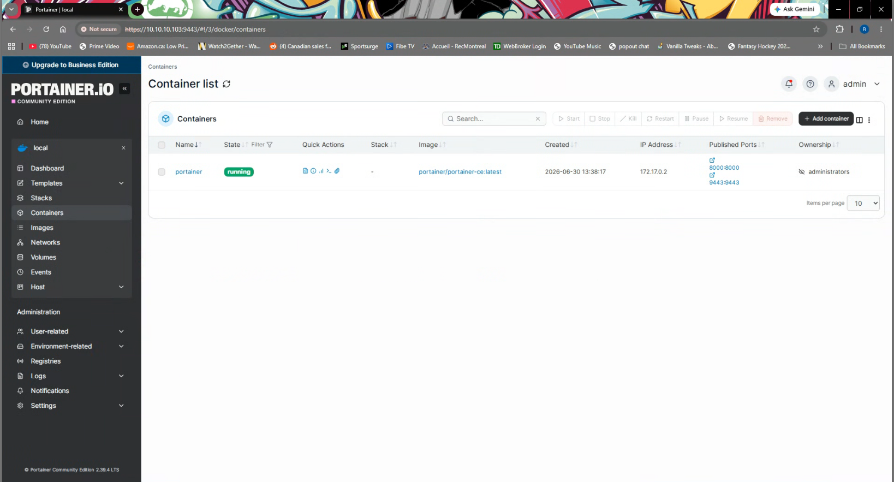

# Docker Host Setup

## What I was doing

I installed Docker Engine and Compose on the Ubuntu VM, then used Portainer to manage containers.

Final validation:



## Packages I used

The target was the official Docker repository rather than the older packages bundled in Ubuntu's default repositories.

Packages:

```bash
docker-ce
docker-ce-cli
containerd.io
docker-compose-plugin
```

## Repository Setup

The modern Ubuntu approach uses a repository file under:

```text
/etc/apt/sources.list.d/docker.list
```

and a signed key under:

```text
/etc/apt/keyrings/
```

## Issue Encountered

`sudo apt update` returned:

```text
NO_PUBKEY 7EA0A9C3F273FCD8
The repository 'https://download.docker.com/linux/ubuntu noble InRelease' is not signed.
```

This meant APT could see the Docker repository, but could not verify it because the expected GPG key was missing, unreadable, or referenced from the wrong path.

## Troubleshooting Performed

- I found and corrected a typo from `sources.list.y` to `sources.list.d`.
- I recreated the Docker repository list file.
- I attempted to place Docker's key under `/etc/apt/keyrings/docker.gpg`.
- I identified that the key file was not present when `chmod` was attempted.
- I switched the plan toward using a readable `.asc` key path.

## Installation Validation Steps

```bash
sudo mkdir -p /etc/apt/keyrings
sudo curl -fsSL https://download.docker.com/linux/ubuntu/gpg -o /etc/apt/keyrings/docker.asc
echo "deb [arch=$(dpkg --print-architecture) signed-by=/etc/apt/keyrings/docker.asc] https://download.docker.com/linux/ubuntu $(lsb_release -cs) stable" | sudo tee /etc/apt/sources.list.d/docker.list > /dev/null
sudo apt update
sudo apt install -y docker-ce docker-ce-cli containerd.io docker-compose-plugin
```

After install:

```bash
sudo systemctl status docker
sudo usermod -aG docker $USER
docker run hello-world
```

## Where I got to

Docker installation was completed successfully. Portainer Community Edition was deployed as a running container and is reachable at:

```text
https://10.10.10.103:9443/
```

Published ports shown in Portainer:

```text
8000:8000
9443:9443
```

The install took a few attempts because of the repository path and missing key. Once those were fixed, Docker and Portainer were running.
