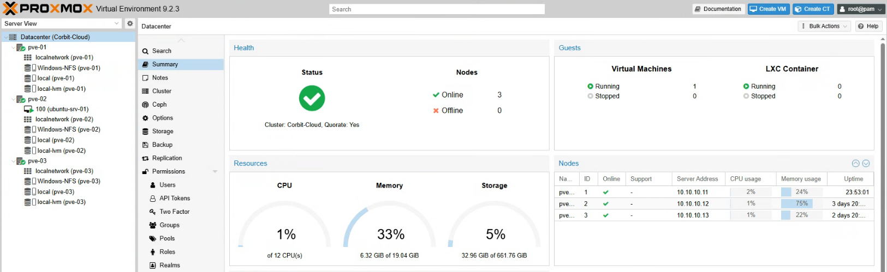

# Windows NFS Shared Storage

## What I was doing

I pooled three SSDs on the Windows Server host and exported the storage over NFS so all three Proxmox nodes could use it.

## Setup used in this build

- Ceph was disabled for the current lab design.
- Three SSDs are pooled on the Windows Server storage host.
- The pooled storage is exported through Windows NFS.
- The Proxmox nodes mount the shared storage as `Windows-NFS`.
- The cluster screenshot below records all three nodes online during the build.

Screenshot:



## Why Windows NFS

This layout fits the current hardware better than Ceph because the SSDs are attached to the Windows Server system instead of being distributed across the Proxmox nodes as dedicated Ceph OSD disks.

This gave all three nodes access to the same storage. It also meant the Windows host and its SSD pool were a shared dependency for VMs with disks on NFS.

## Architecture

```text
Windows Server pooled SSD storage
        |
        | NFS export
        v
Proxmox storage target: Windows-NFS
        |
        +-- pve-01
        +-- pve-02
        +-- pve-03
```

## Notes

I did not use Ceph for this build. The exact Windows export path and pool layout still need to be added to these notes.
