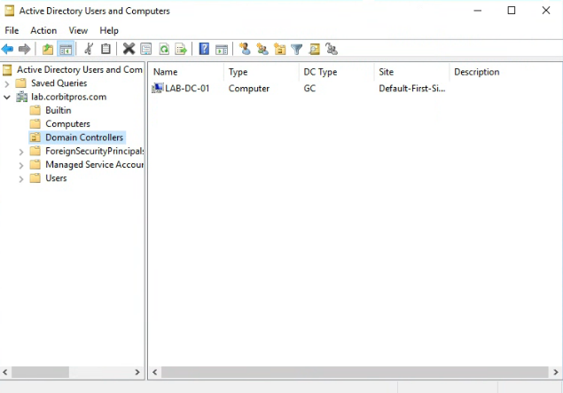
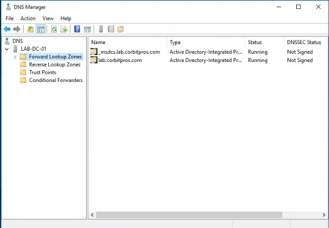
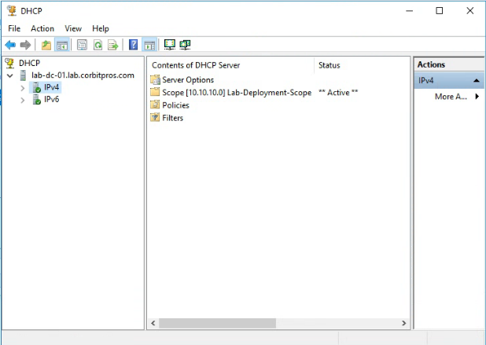
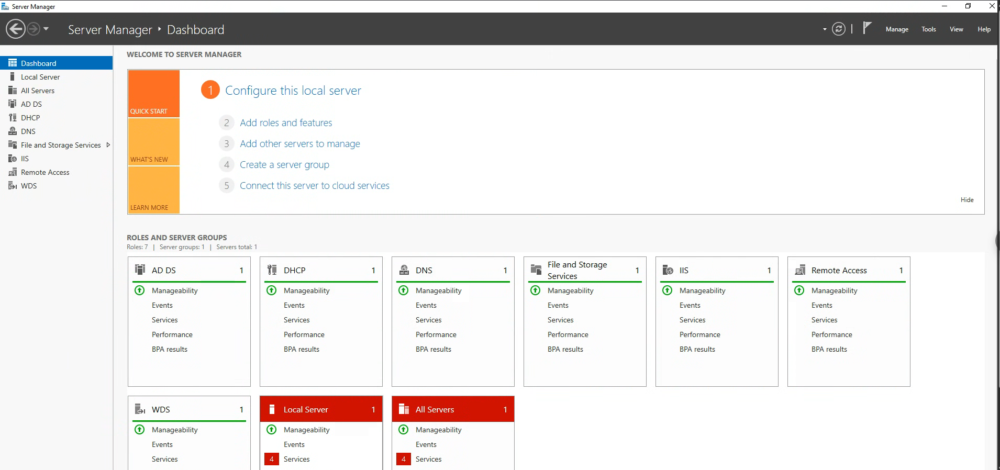

# Active Directory, DNS, and DHCP

I used the Windows Server 2016 desktop as the domain controller, DNS server, and DHCP server for the lab.

| Item | Value |
| --- | --- |
| AD DNS domain | `lab.corbitpros.com` |
| Domain controller | `LAB-DC-01.lab.corbitpros.com` |
| Lab-side server IP | `10.10.10.2` |
| Lab network | `10.10.10.0/24` |

## Active Directory

I installed AD DS and promoted the server to a domain controller. The AD console below shows the lab domain. Older notes used the shorter `corbitpros.com` name; the actual AD namespace shown in the screenshots is `lab.corbitpros.com`.

I later joined the WDS-imaged client to this domain and moved it into a `Workstations` OU. Those commands and the Group Policy tests are in the [Group Policy notes](group-policy.md).

## DNS

I configured DNS with the domain controller so clients could resolve the lab's names and find AD services.

## DHCP

DHCP didn't show up the way I expected at first. I checked the authorized servers list and found the server was already authorized. After rechecking the role and console, it appeared correctly. I didn't pin down a separate authorization fault.

The later [PXE boot screenshot](windows-deployment-services.md#pxe-boot-and-client-imaging) shows the client receiving `10.10.10.100` from DHCP server `10.10.10.2`.

## Checks I made

I checked DHCP authorization, server visibility in the management consoles, and connectivity between the switch and server. The WDS deployment and domain-joined client gave me a practical way to test the services together.

