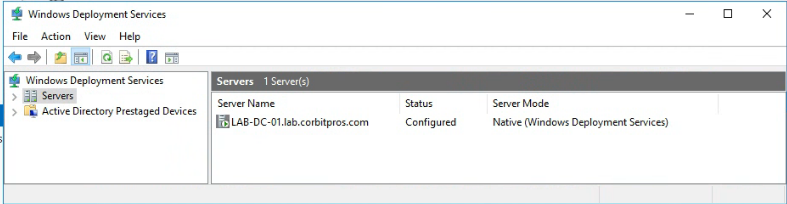
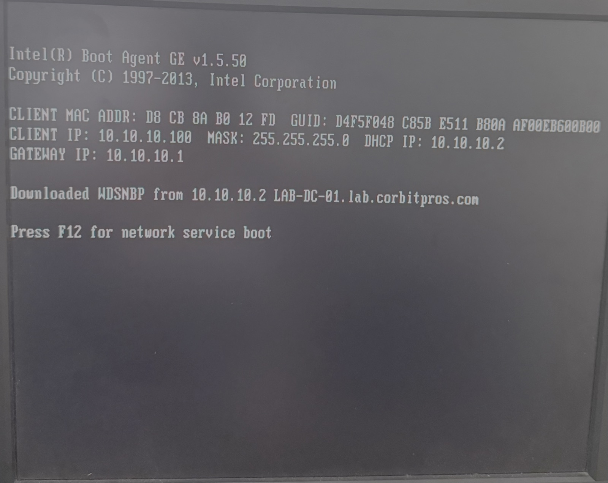
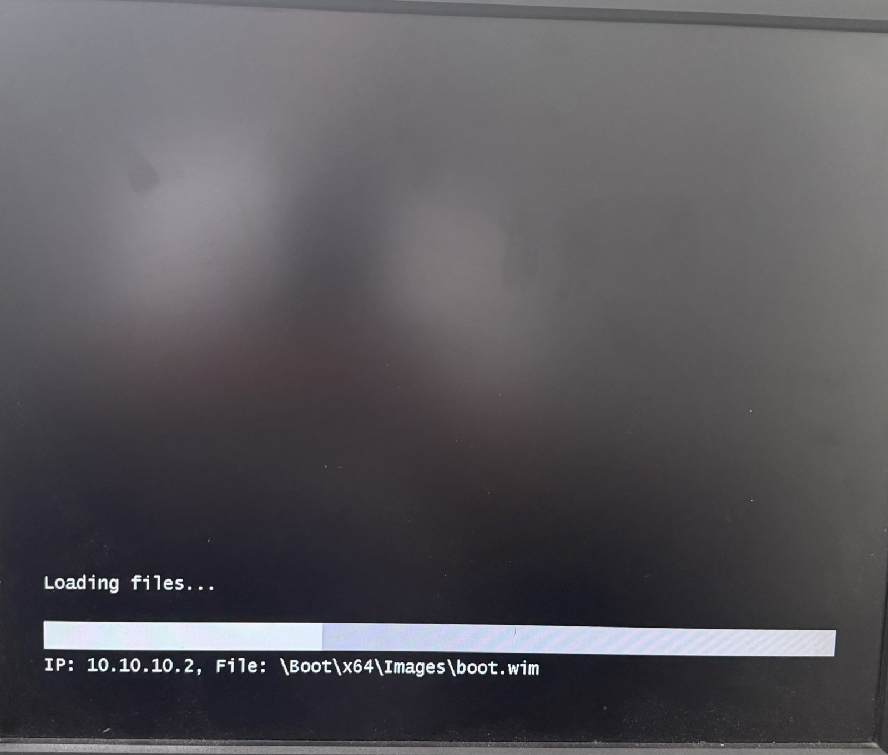
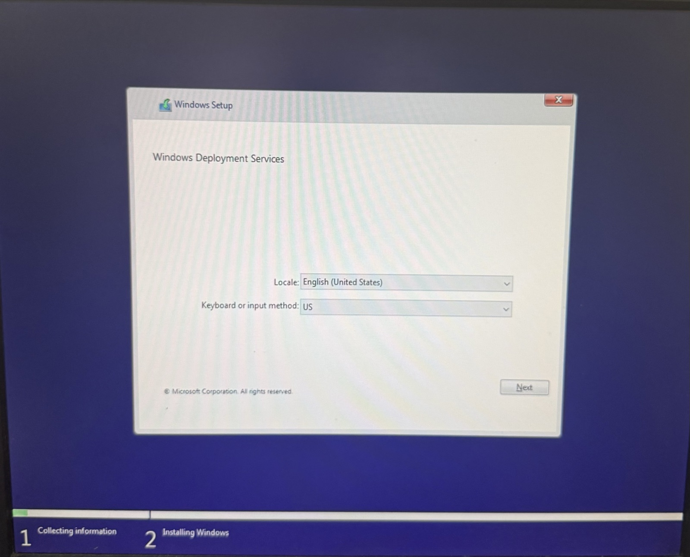
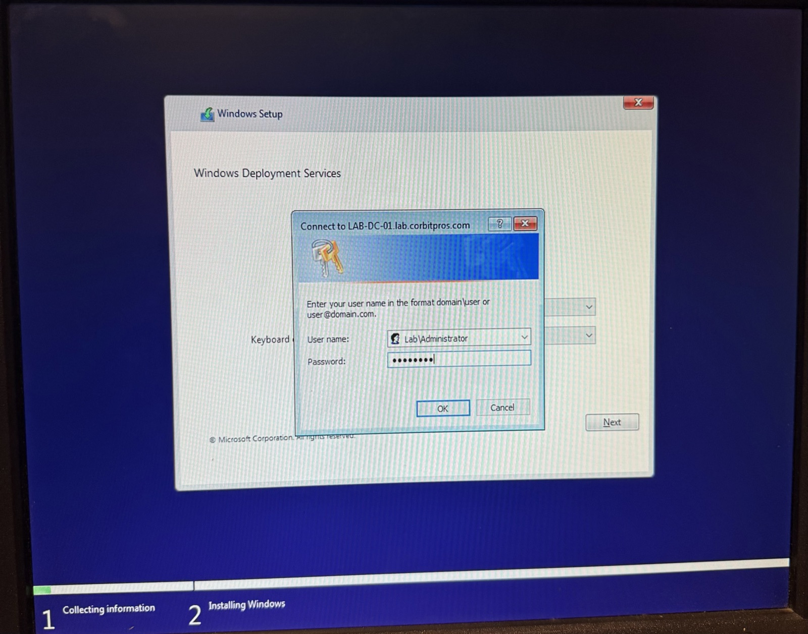
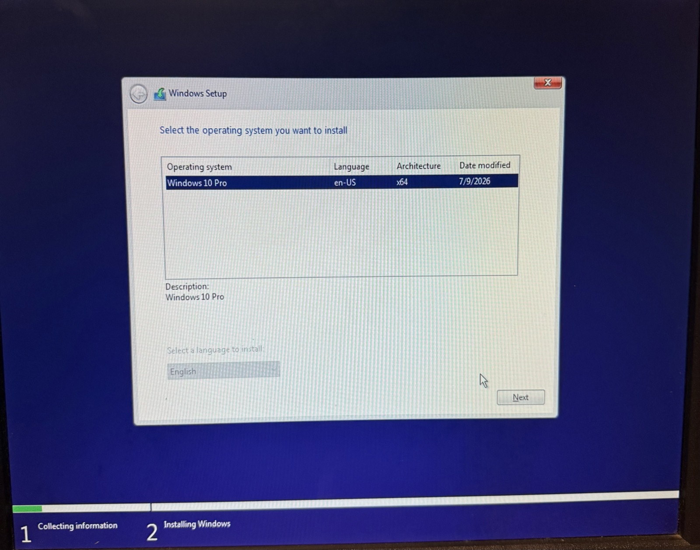
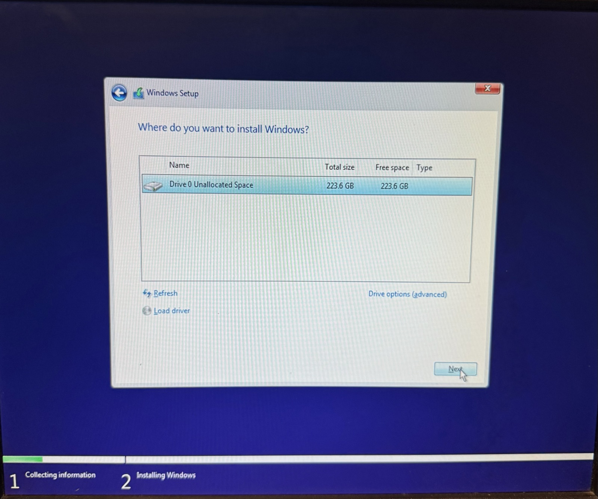
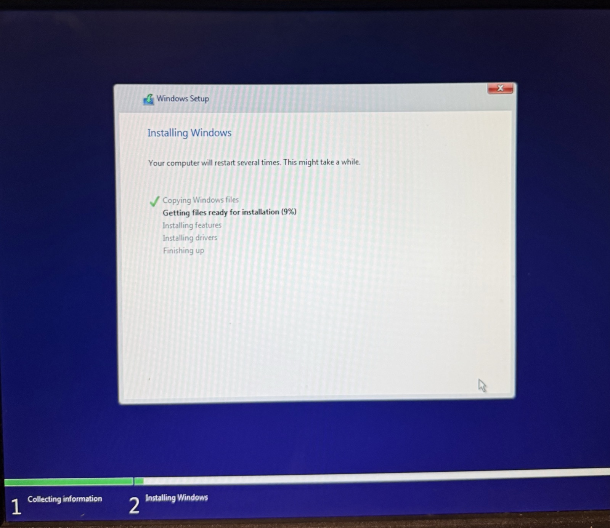
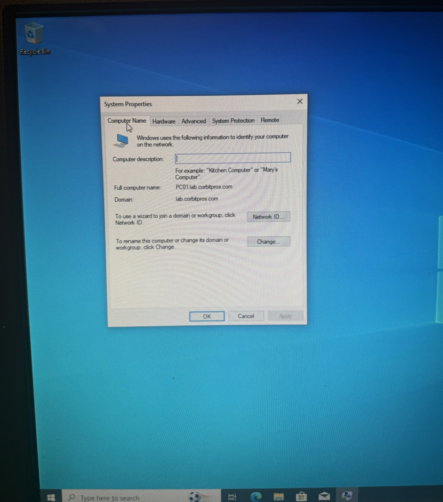

# Windows Deployment Services

## What I was doing

I set up WDS on the Windows Server desktop and used it to install Windows 10 on a spare mini PC over the network.

## Reason for WDS

I had several mini PCs to work with and wanted to try network imaging instead of installing each one from USB.

## Setup sequence

1. Install the WDS role on Windows Server 2016.
2. Configure WDS for integrated Active Directory operation.
3. Create an image group, such as `Windows_10_Enterprise`.
4. Add boot images from Windows installation media.
5. Add install images when ISO media is available.
6. PXE boot mini PCs from the lab network.
7. Deploy Windows images over the network.

## Where I got to

- WDS role was installed and configured.
- Server `LAB-DC-01.lab.corbitpros.com` appears in WDS as configured.
- Server mode is native Windows Deployment Services.
- A Windows 10 boot image was added and staged for PXE deployment.
- A spare mini PC was PXE-booted against WDS and imaged end to end.
- The imaged client auto-joined the `lab.corbitpros.com` domain during the unattended install.

Screenshot:



## PXE Boot and Client Imaging

The target mini PC was set to PXE boot and picked up the Intel Boot Agent handshake against the WDS server:

```text
CLIENT IP: 10.10.10.100   DHCP IP: 10.10.10.2   GATEWAY IP: 10.10.10.1
Downloaded WDSNBP from 10.10.10.2 LAB-DC-01.lab.corbitpros.com
```



The boot image streamed over the network from the WDS server:

```text
Loading files...
IP: 10.10.10.2, File: \Boot\x64\Images\boot.wim
```



Windows Setup launched in WDS mode, prompting for locale and keyboard layout:



Setup then required domain credentials to authenticate against the WDS server before continuing:



The staged Windows 10 Pro image was selected from the available install images:



The target disk (223.6 GB unallocated) was selected for installation:



Windows installed over the network without further input, restarting several times as expected:



The unattended install joined the machine to the domain automatically, without a manual domain-join step.

## Post-Imaging Cleanup

I renamed the client to `PC01` after imaging. During cleanup I had trouble finding it under the new name and refreshed its DNS registration before doing the [OU move](group-policy.md).

Resolved by running, on the client, after the rename and reboot:

```powershell
ipconfig /flushdns
ipconfig /registerdns
```

After the rename, reboot, and DNS refresh, I found the `PC01` computer object and moved it into `Workstations`. These commands refresh DNS; they do not rename an AD computer object. I did not isolate DNS as the cause of the AD lookup problem.



`System Properties` confirms the final state: full computer name `PC01.lab.corbitpros.com`, domain `lab.corbitpros.com`.
